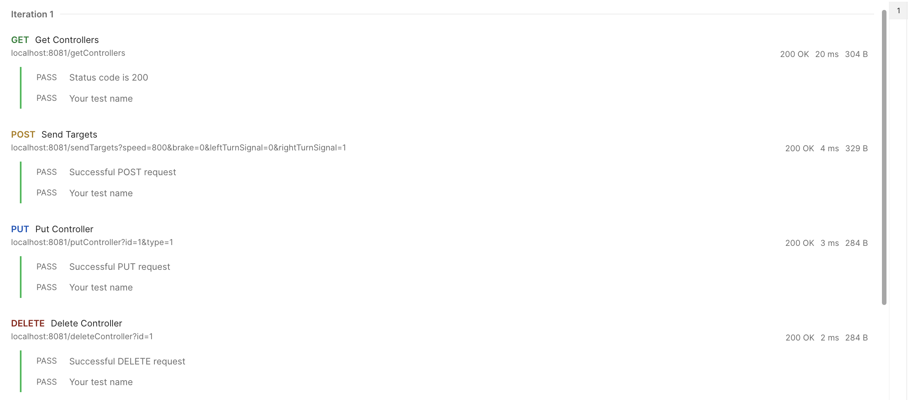
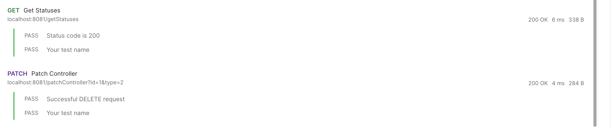

# Лабораторная работа №4
## Глоссарий структур
### Статус
Входимые параметры:
- Скорость (целочисл.)
- Тормозное усилие (целочисл.)
- Работа левого поворотника (логическое)
- Работа правого поворотника (логическое)
## Принятые проектные решения (документирование API)
### Получить статусы от контроллеров
Метод: `GET`

Эндпоинт: `/getStatuses`

Описание: Возвращает массив статусов 

Параметры: отсутствуют

Возвращаемые данные: массив структур в обёртке json

Возможные ошибки:
- `204` - контроллеры в сети отсутствуют

Пример:
- Запрос: `localhost:8081/getStatuses`
- Ответ:
```
[
    {
        "id": 1,
        "speed": 800,
        "brake": 0,
        "leftTurnSignal": 0,
        "rightTurnSignal": 1
    }
]
```

### Назначить целевые параметры
Метод: `POST`

Эндпоинт: `/sendTargets`

Описание: Устанавливает новые целевые значения

Параметры:
- `speed` Показатель скорости; целое число в диапазоне [0-1023]
- `brake` Показатель торможения; целое число в диапазоне [0-1023]
- `leftTurnSignal` Работа левого поворотника; целое число в диапазоне [0-1]
- `rightTurnSignal` Работа правого поворотника; целое число в диапазоне [0-1]

Возвращаемые данные: Возвращает все переданные параметры в обёртке json

Возможные ошибки:
- `204` - контроллеры в сети отсутствуют

Пример:
- Запрос: `localhost:8081/sendTargets?speed=800&brake=0&leftTurnSignal=0&rightTurnSignal=1`
- Ответ:
```
{
    "speed": 800,
    "brake": 0,
    "leftTurnSignal": 0,
    "rightTurnSignal": 1
}
```

### Получить список контроллеров
Метод: `GET`

Эндпоинт: `/getControllers`

Описание: Возвращает массив с id контроллеров и их типами

Параметры: отсутствуют

Возвращаемые данные: массив с id контроллеров и их типами

Возможные ошибки:
- `400` - ошибка в данных (не целое число или число не в диапазоне)

Пример:
- Запрос: `localhost:8081/getControllers`
- Ответ:
```
[
    {
        "id": 0,
        "type": 0
    },
    {
        "id": 1,
        "type": 1
    }
]
```

### Добавить новый контроллер в сеть
Метод: `PUT`

Эндпоинт: `/putController`

Описание: Добавляет контроллер в сеть

Параметры:
- `id` id контроллера; целое число в диапазоне [0-256]
- `type` Тип контроллера; целое число в диапазоне [0, 1, 2] (0 - ведущий контроллер; 1 - ведомый контроллер; 2 - контроллер-наблюдатель)

Возвращаемые данные: id добавленного контроллера и его тип в обёртке json

Возможные ошибки:
- `400` - ошибка в данных (не целое число или число не в диапазоне)
- `409` - контроллер с таким id уже существует

Пример:
- Запрос: `localhost:8081/putController?id=1&type=1`
- Ответ:
```
{
    "id": 1,
    "type": 1
}
```

### Изменить контроллер в сети
Метод: `PATCH`

Эндпоинт: `/patchController`

Описание: Изменяет тип контроллера в сети

Параметры:
- `id` id контроллера; целое число в диапазоне [0-256]
- `type` Тип контроллера; целое число в диапазоне [0, 1, 2] (0 - ведущий контроллер; 1 - ведомый контроллер; 2 - контроллер-наблюдатель)

Возвращаемые данные: id изменённого контроллера и его тип в обёртке json

Возможные ошибки:
- `400` - ошибка в данных (не целое число или число не в диапазоне)
- `404` - контроллер с таким id не найден

Пример:
- Запрос: `localhost:8081/patchController?id=1&type=2`
- Ответ:
```
{
    "id": 1,
    "type": 2
}
```

### Удалить контроллер из сети
Метод: `DELETE`

Эндпоинт: `/deleteController`

Описание: Удаляет контроллер из сети

Параметры:
- `id` id контроллера; целое число в диапазоне [0-256]

Возвращаемые данные: id удалённого контроллера и его тип в обёртке json

Возможные ошибки:
- `400` - ошибка в данных (не целое число или число не в диапазоне)
- `404` - контроллер с таким id не найден

Пример:
- Запрос: `localhost:8081/deleteController?id=1`
- Ответ:
```
{
    "id": 1,
    "type": 2
}
```

## Тестировнаие API


